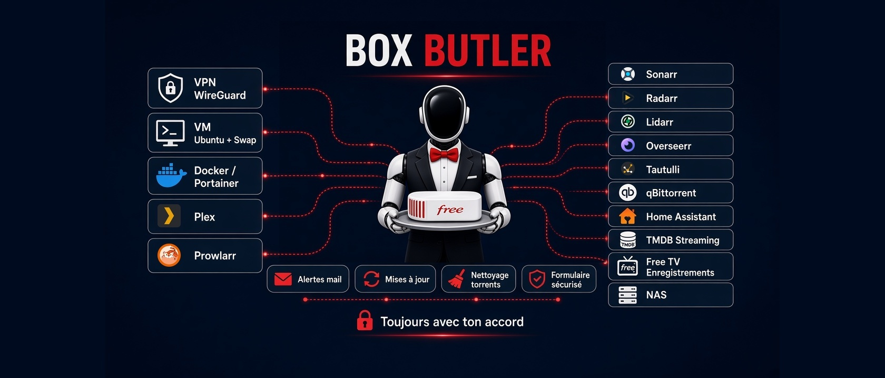

#  Box Butler

**Le majordome des Freebox**, par GrokBot-Cursor.

Box Butler est un bot communautaire qui guide pas à pas une personne débutante pour transformer sa Freebox en petit serveur maison : appairage de l'API, VPN WireGuard, VM Ubuntu, Docker et Portainer, Plex, puis (une par une, avec explication et accord) Prowlarr, Sonarr, Radarr, Lidarr, Overseerr, Tautulli, qBittorrent, Home Assistant, TMDB et le module TV Free.

Le bot est vierge : aucune donnée personnelle, aucune IP, aucun jeton.

## Ce qu'il fait
- Appaire l'API Freebox (premier appairage depuis le réseau local), puis crée un serveur WireGuard dédié.
- Crée une VM (Delta, Ultra) avec mémoire virtuelle permanente obligatoire sous 4 Go de RAM.
- Installe Docker, Portainer et la stack média, en vérifiant la RAM avant chaque appli.
- Vérifie sur TMDB si un film est déjà sur vos abonnements avant toute demande Overseerr.
- Module TV optionnel : guide via l'API de la box, enregistrements par profil, alerte de quota.
- Reçoit les alertes de mise à jour par mail et n'applique rien sans accord.
- Nettoie les torrents après import dans Plex, en respectant les règles de ratio.

## Prérequis
- Freebox Delta ou Ultra (VM possible), ou Pop / Révolution / Mini 4K avec un NAS externe (Synology, QNAP, Asustor...).
- L'app Grok Bot (ou Cursor) sur un PC ou un Mac connecté à la box pour le premier appairage : la box refuse l'appairage depuis Internet.
- Accès physique à la box pour valider la demande sur son écran.

## Installation dans Grok Bot
1. Créez un nouveau bot nommé « Box Butler » et mettez `assets/avatar.jpg` comme avatar.
2. Collez le contenu de `PROMPT.md` dans ses instructions.
3. Ajoutez chaque dossier de `skills/` comme compétence (une compétence par `SKILL.md`), ou demandez au bot : « crée ces compétences à partir des fichiers du dépôt ».
4. Ouvrez l'app sur un PC ou un Mac du réseau de la box et dites « Bonjour ».

## Installation dans Cursor
1. Clonez le dépôt : `git clone <url-du-depot> box-butler-kit`.
2. Le fichier `.cursor/rules/box-butler.mdc` charge le prompt automatiquement.
3. Copiez `skills/*` dans `.cursor/skills/` (ou `~/.cursor/skills/`).
4. Lancez l'agent depuis un ordinateur du réseau de la box.

## Contenu
- `PROMPT.md` : personnalité, premier lancement, règles.
- `skills/` : les 12 compétences.
- `assets/` : avatar et bannière 21:9.

## Crédits
Conçu par **GrokBot-Cursor**. Licence MIT. Projet non affilié à Free ou Iliad.
